  

# 🤖 Awesome AI Frameworks

  
  
  
  
  

  <b>A curated, production-focused directory of leading SaaS platforms and open-source AI frameworks for autonomous multi-agent orchestration, Retrieval-Augmented Generation (RAG) pipelines, LLMOps, and enterprise AI application engineering.</b>

---

## 🧭 Sector Overview & Market Dynamics

The global AI orchestration and autonomous agent frameworks market is currently valued between **$9.7B and $14B**, on track to expand at a **~22% to 35%+ CAGR** to surpass **$50B+** by the early 2030s.

The market exhibits a distinct **dual-tier dynamic**:
- 🧩 **Developer Tooling & Open-Source Ecosystem (Highly Fragmented):** Constant innovation across agent memory, tool routing, cognitive architectures, and visual canvases gives rise to dozens of vibrant open-source frameworks.
- 🏢 **Enterprise Governance & Runtime Infrastructure (Moderately Concentrated):** Commercial agent runtimes, observability suites, and production security layers are concentrating around leading platform players and hyperscalers offering compliance, deterministic guardrails, and enterprise SLAs.

---

## 📑 Table of Contents

- [🧭 Sector Overview & Market Dynamics](#-sector-overview--market-dynamics)
- [☁️ SaaS & Managed Hosted Platforms](#️-saas--managed-hosted-platforms)
- [📦 Top Open-Source Frameworks & Repositories](#-top-open-source-frameworks--repositories)
- [⭐ Star History](#-star-history)
- [🤝 How to Contribute](#-how-to-contribute)
- [💖 Support & Sponsorship](#-support--sponsorship)
- [⚖️ Disclaimer](#️-disclaimer)

---

## ☁️ SaaS & Managed Hosted Platforms

*A market-cap and valuation-ranked comparison of managed cloud platforms for multi-agent workflows, model observability, and AI application builders.*

| Platform | Company / Parent | Valuation / Revenue Scale | Starting Paid Tier Pricing | Free Tier / Trial Limit | Key Features |
| :--- | :--- | :--- | :--- | :--- | :--- |
| **[AutoGen Studio](https://microsoft.github.io/autogen/)** | Microsoft | **~$3.1T Market Cap** / $245B+ Annual Revenue | **$0.00** platform fee (Pay-as-you-go via Azure OpenAI / Azure Container compute; e.g., Azure OpenAI tokens from ~$0.15/1M tokens) | **Free & open-source interface**; Azure free trial provides **$200 credit for 30 days** plus 55+ services free for 12 months | Multi-agent conversation orchestration, declarative agent configuration, local & cloud execution harness |
| **[LangFlow Cloud](https://www.langflow.org/)** | DataStax (IBM subsidiary) | **~$210B Market Cap** (IBM) / DataStax acquired for **~$1.6B valuation** | **Pay-as-you-go / Standard tier** starting with consumption credits; Astra DB serverless paid plans from **$0.25/1M read units** | **Free forever tier**: Fixed free monthly Astra DB credits, up to 5 active serverless databases (auto-hibernated on credit exhaustion) | Visual drag-and-drop LLM builder, native Astra vector database integrations, MCP server components |
| **[Flowise Cloud](https://flowiseai.com/)** | FlowiseAI (Acquired by Workday) | **~$70B Market Cap** (Workday) / Flowise Seed ~$500K, ~$1M ARR | **Starter: $35/month** | **Free forever plan**: Capped at **2 flows, 100 predictions/month, and 5 MB storage** | Low-code drag-and-drop workflow canvas, custom tool builders, embedded chat widgets, and API endpoints |
| **[LangSmith](https://smith.langchain.com/)** | LangChain | **$1.25B – $1.3B Valuation** (Series B, ~$12M–$16M ARR) | **Plus: $39/seat/month** | **Free Developer plan**: 1 user seat, **5,000 base traces/month**, community support | End-to-end LLM observability, trace evaluation, prompt playground, dataset curation, and latency/cost tracking |
| **[Dify Cloud](https://dify.ai/)** | LangGenius | **$180M Valuation** (Series Pre-A, $30M raised) | **Professional: $59/workspace/month** | **Sandbox (Free forever)**: 1 workspace, 1 member, **5 apps, 50 knowledge docs (~50 MB storage), and 200 system model credits** | Visual agentic orchestration, RAG pipelines, model router, prompt engineering tools, and team collaboration |
| **[CrewAI Enterprise](https://www.crewai.com/)** | CrewAI | **~$100M Valuation** ($18M Series A) | **Enterprise: Custom / Quote-based** (Annual contracts starting at **~$6,000/year**) | **Basic (Free forever)**: CrewAI Studio visual editor, copilot, and **50 workflow executions/month** | Collaborative multi-agent teams, role-playing agents, orchestration governance, enterprise SSO, and execution telemetry |

---

## 📦 Top Open-Source Frameworks & Repositories

*Ranked in descending order by GitHub Stars. Star count badges link directly to each repository's stargazers community.*

1. **[AutoGPT](https://github.com/Significant-Gravitas/AutoGPT)**   
   🚀 **The pioneering autonomous agent framework** (MIT). One of the fastest-growing open-source projects in GitHub history. Empowers autonomous agents with recursive execution, long-term memory, modular agent blocks, and multi-agent coordination.

2. **[Dify](https://github.com/langgenius/dify)**   
   🛠️ **Complete open-source LLM app development platform** (Apache-2.0 with conditions). Seamlessly combines visual agentic workflow orchestration, production RAG pipelines, model management, prompt studio, and observability into a self-hostable full-stack suite.

3. **[Langflow](https://github.com/langflow-ai/langflow)**   
   🎨 **Visual framework for building multi-agent and RAG applications** (MIT). Provides a modular node-based canvas for assembling LLM components, tools, agents, vector stores, and Model Context Protocol (MCP) servers with instant API deployment.

4. **[LangChain](https://github.com/langchain-ai/langchain)**   
   ⛓️ **The foundational industry standard for building LLM applications** (MIT). Features modular abstractions for chains, tools, memory, and cognitive architectures (`create_agent`, LangGraph), supported by the vast LangChain ecosystem.

5. **[RAGFlow](https://github.com/infiniflow/ragflow)**   
   📄 **Next-gen open-source RAG engine based on deep document understanding** (Apache-2.0). Solves grounded retrieval by parsing complex multi-format unstructured data (PDFs, docs, tables) with deterministic chunking and hybrid search.

6. **[MCP Servers](https://github.com/modelcontextprotocol/servers)**   
   🔌 **Reference implementations for the Model Context Protocol (Anthropic)** (MIT). The open interoperability protocol connecting AI models and agents securely to real-world data sources, enterprise tools, and local development environments.

7. **[MetaGPT](https://github.com/geekan/MetaGPT)**   
   🏢 **Multi-agent collaborative framework simulating software companies** (MIT). Assigns distinct agent personas (Product Manager, Architect, Tech Lead, Engineer, QA) that collaborate via Standardized Operating Procedures (SOPs) to produce full software deliverables.

8. **[AutoGen](https://github.com/microsoft/autogen)**   
   🤖 **Enterprise multi-agent conversation framework by Microsoft** (MIT). Enables next-generation event-driven multi-agent systems with conversational collaboration, nested group chats, tool-calling, and human-in-the-loop oversight.

9. **[CrewAI](https://github.com/crewAIInc/crewAI)**   
   👥 **Role-based multi-agent collaboration framework** (MIT). Highly intuitive abstractions allowing developers to define specialized agents with roles, goals, tools, and backstories that collaborate autonomously across sequential or hierarchical tasks.

10. **[Flowise](https://github.com/FlowiseAI/Flowise)**   
    🖱️ **Low-code drag-and-drop LLM app and chatbot builder** (Apache-2.0). Build custom LLM pipelines, RAG chatbots, vector database lookups, and autonomous agents visually with TypeScript and Node.js.

11. **[LlamaIndex](https://github.com/run-llama/llama_index)**   
    🗂️ **The premier data and context framework for LLM applications** (MIT). Specializes in connecting external enterprise knowledge to LLMs with 300+ data loaders, indexing strategies, advanced query engines, and agentic workflows.

12. **[Agno (formerly Phidata)](https://github.com/agno-agi/agno)**   
    ⚡ **High-performance, lightweight full-stack agent framework** (MIT). Build multi-modal agents with structured memory, hybrid search, streaming responses, and specialized toolsets at ultra-low latency.

13. **[DSPy](https://github.com/stanfordnlp/dspy)**   
    🎓 **Stanford framework for programming—not prompting—foundation models** (MIT). Replaces brittle hand-written prompts with composable modules and teleprompters (optimizers) that algorithmically tune prompts and weights.

14. **[GPT Researcher](https://github.com/assafelovic/gpt-researcher)**   
    🔍 **Autonomous agent for in-depth web and document research** (Apache-2.0). Employs parallel agent workers to scrape, aggregate, filter, and cross-reference 20+ web sources into comprehensive, cited research dossiers.

15. **[smolagents](https://github.com/huggingface/smolagents)**   
    🤗 **Minimalist code-first agent framework from Hugging Face** (Apache-2.0). Lets agents execute tool actions directly by writing clean Python code snippets rather than parsing complex JSON blobs, yielding faster execution and smaller footprints.

16. **[Semantic Kernel](https://github.com/microsoft/semantic-kernel)**   
    🏢 **Microsoft's enterprise SDK for AI integration** (MIT). Multi-language SDK (C#, Python, Java) designed to orchestrate LLM prompts, agent personas, native plugins, memory, and planner mechanisms in high-scale enterprise codebases.

17. **[Vercel AI SDK](https://github.com/vercel/ai)**   
    🌐 **Unified TypeScript toolkit for AI user interfaces** (Apache-2.0). The industry standard for building reactive, streaming AI frontends and agentic backends with React, Next.js, Vue, and Svelte.

18. **[Haystack (deepset)](https://github.com/deepset-ai/haystack)**   
    🌾 **Modular Python framework for production search and RAG** (Apache-2.0). Build custom end-to-end NLP pipelines with interchangeable vector databases, retrievers, document splitters, and generator models.

19. **[Letta (formerly MemGPT)](https://github.com/letta-ai/letta)**   
    🧠 **Stateful AI agents with perpetual long-term memory** (Apache-2.0). Pioneers hierarchical memory management (working context, archival storage, recall) that allows agents to learn continuously across infinite sessions.

20. **[Swarm](https://github.com/openai/swarm)**   
    🐝 **Educational multi-agent orchestration framework by OpenAI** (MIT). Minimalist educational framework demonstrating multi-agent coordination through routines, state encapsulation, and lightweight handoffs.

21. **[PydanticAI](https://github.com/pydantic/pydantic-ai)**   
    🛡️ **Type-safe agent framework from the creators of Pydantic** (MIT). Brings production-grade type validation, dependency injection, and deterministic structured outputs to LLM agent engineering in Python.

22. **[XERJ](https://github.com/xerj-org/xerj)**   
    ⚡ **Rust-powered local autoindex and retrieval engine for coding agents** (Apache-2.0). Token-efficient local retrieval layer with Elasticsearch-compatible APIs, achieving up to 2.7x fewer output tokens than grep-based coding context retrieval.

---

## 📈 Star History

---

## 🤝 How to Contribute

Contributions are warmly welcomed! Help keep this ecosystem guide fresh, accurate, and valuable for the AI developer community:

1. 🍴 **Fork the repository** to your GitHub account.
2. 🌿 **Create a descriptive feature branch** (`git checkout -b feature/add-new-framework`).
3. 📝 **Add or update the framework entry** in [`README.md`](file:///C:/Users/ishan/Documents/Projects/Awesome-AI-Frameworks/README.md) following the established format (social star badge, license, and concise description).
4. 🚀 **Submit a Pull Request** explaining the additions or modifications.

---

## 💖 Support & Sponsorship

If you find this curated ecosystem directory helpful for your projects, research, or architecture design, please consider showing your support:

- ⭐ **Star this repository** to improve discoverability for other developers.
- 🍴 **Fork and share** with colleagues and across developer communities.
- ☕ **Buy me a coffee & sponsor my open-source work**: Support sustained updates and maintenance via the **[GitHub Sponsors Dashboard](https://github.com/sponsors/ishandutta2007)**.

  

---

## ⚖️ Disclaimer

- This repository is a **community-curated collection** provided for educational and architectural reference purposes only; inclusion does not constitute an endorsement.
- All trademarks, logos, and brand names are the property of their respective owners.
- When deploying AI frameworks into production environments, ensure full compliance with relevant data privacy laws (GDPR, CCPA, HIPAA), security auditing practices, and the terms of service of underlying model providers.

---

  <b>Built with ❤️ for the global AI engineering, autonomous agent, and LLMOps community.</b>

